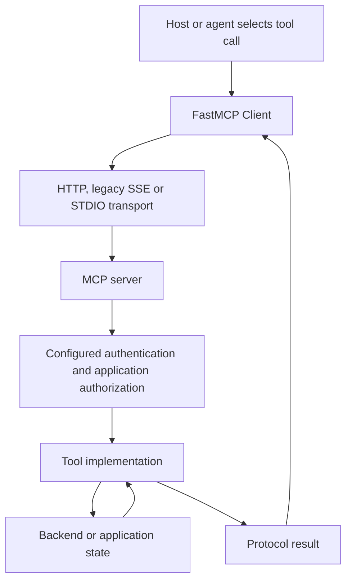
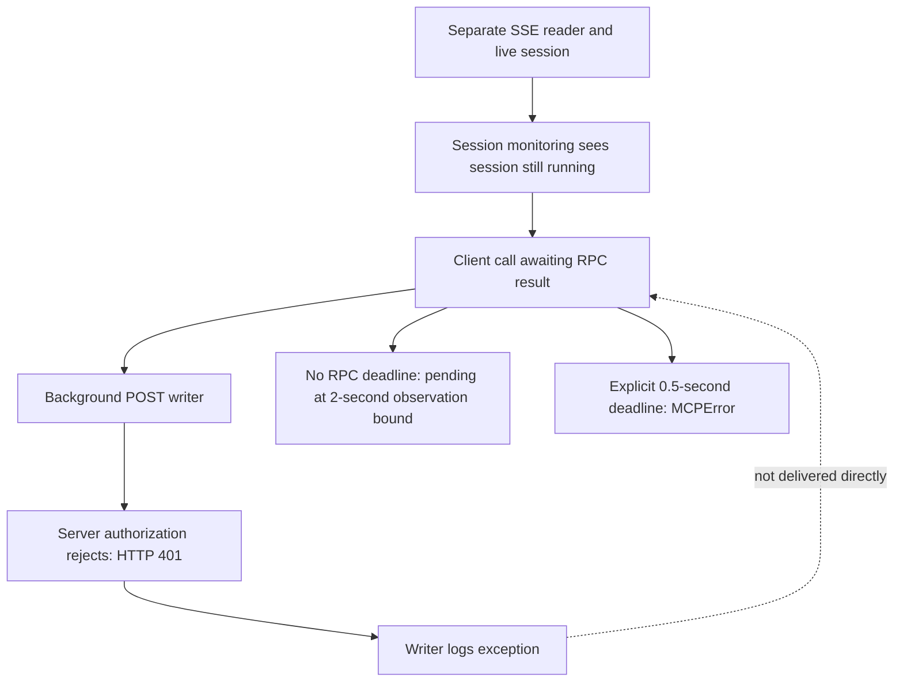

# Architecture and flows

## 1. Normal tool request



The model proposes a call; runtime code executes it. Tool metadata is not an object-level permission check. Authentication identifies a caller; scopes, tenant and object rules still depend on the configured server/application.

## 2. Observed legacy SSE failure



This is the recorded failure/control comparison, not one combined execution. In ordinary success, results arrive over the separate event stream. The two-second bound belongs to the test harness, not the SDK's intrinsic deadline. HTTP 401 was the expected server denial.

## 3. Independent liveness control

```text
Original RPC remains pending
    ├─ separate authorized client → tool completes
    └─ event-loop heartbeat → completes
Then: original RPC still pending at bound → harness cancellation/cleanup
```

A pending asynchronous operation is not the same as a blocked event loop or unavailable application.

## 4. Shared OAuth state

```text
Process A → OAuthContext A + lock A ─┐
                                   ├→ shared persisted token storage
Process B → OAuthContext B + lock B ─┘
```

Database sharing does not serialize both live contexts' refresh operations. Under the owned provider's rotation policy, one initial collision led to reauthorization. Later successful cycles used different token pairs; they did not prove cross-process deduplication.

Persistence path: token pair write → separate absolute-expiry write. The controlled exit between these operations explains the observed mixed state.

## 5. Consumer source trace: not a new runtime test

```text
EpicStaff Redis stream → consume_requests → RequestHandler → runner
    → AgentResolver / DefaultAgentLoop → ToolRegistry → McpToolExecutor
    → McpToolGateway → fresh Prefect Client → SSETransport → MCP SDK
```

Documented SSE configuration and URL inference establish a supported path. Request timeout 30 s → Client session kwargs → ClientSession response receive deadline. Initialize handshake separately 10 s. Optional tool/loop budgets are not assumed enabled; graceful shutdown waits for in-flight runs.

## 6. Assessment workflow

```text
Pin source/dependencies → define expected boundary
→ owned positive/negative checks → inspect server result and tool counters
→ trace client/dependency state → test alternative explanations
→ keep functional defects separate from security claims
```
