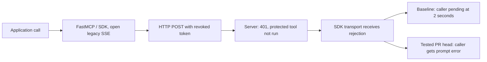

# FastMCP: server rejected a call, client kept waiting

**Status:** client/dependency error-handling bug; no authorization bypass demonstrated.

FastMCP connects applications to MCP tools. We tested a protected call over an open legacy SSE connection after its token was revoked.

- **Expected:** server denies access; the application promptly receives an error.
- **Observed:** HTTP 401 blocked the tool, but the client call stayed pending at the two-second test bound. A configured deadline produced a timeout instead.
- **Impact:** the calling application waited unnecessarily. Independent work continued; an application-wide outage was not demonstrated.
- **Fix verification:** upstream SDK PR #3278 head `66a9285` returned an error promptly and passed the selected reauthorization control, unlike base `a4f4ccd`. This is scoped verification, not a shipped-release claim.

## Flow

## How to read

The summary and flow above explain the main result. Expand **Technical details** to inspect test cases, supporting records and exact versions.

Technical details: matrices and evidence

1. Read the summary and flow to separate server denial from client error delivery.
2. Open [SSE](matrices/SSE.json), row `FM-ERROR`, for the base/head comparison; then [AUTH](matrices/AUTH.json) for access controls. `invariant` is the required rule, `oracle` the measurement, and `observed` the result.
3. Follow `evidence[].url`; a `pointer`, when present, selects a nested JSON entry. Read `status` with `limits`: fix verification applies to the stated scenario and commits.

### Matrices

| Boundary | JSON |
| --- | --- |
| Credential denial / revocation compatibility | [AUTH](matrices/AUTH.json) |
| Error propagation, deadline and recovery | [SSE](matrices/SSE.json) |
| Refresh coordination and crash consistency | [OAUTH-STORAGE](matrices/OAUTH-STORAGE.json) |
| Chosen owner-only deployment policy | [OS-ISOLATION](matrices/OS-ISOLATION.json) |

[Evidence archive: detailed report, tests, logs and source pins](https://github.com/Keedz1Off/fastmcp-auth-state-sse-case-study/tree/291534dd73ebc992db23b9e1834dc9ed151c3246) are preserved in the pinned evidence snapshot. Matrix links open the exact supporting records.

FastMCP 4359485; selected MCP SDK environments and PR #3278 base/head. Independent, AI-assisted work. Documentation reorganisation only; no new target tests. [File inventory](package-manifest.json).

