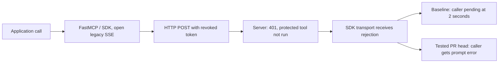

# FastMCP: server rejected a call, client kept waiting

**Status:** client/dependency error-handling bug; no authorization bypass demonstrated.

FastMCP connects applications to MCP tools. We tested a protected call over an open legacy SSE connection after its token was revoked.

- **Expected:** server denies access; the application promptly receives an error.
- **Observed:** HTTP 401 blocked the tool, but the client call stayed pending at the two-second test bound. A configured deadline produced a timeout instead.
- **Impact:** the calling application waited unnecessarily. Independent work continued; an application-wide outage was not demonstrated.
- **Fix verification:** upstream SDK PR #3278 head `66a9285` returned an error promptly and passed the selected reauthorization control, unlike base `a4f4ccd`. This is scoped verification, not a shipped-release claim.

## Where to start

| Open | What you will find |
| --- | --- |
| [Flow](#flow) | See where the server denies the call and where the caller waits. |
| [Boundary index](matrices/boundaries.json) | Choose an authorization, transport, storage or deployment check. |
| [Recorded SDK comparison](evidence/pr3278-verification.json) | Read the baseline and proposed-fix outcomes side by side. |
| [GitHub Actions](#github-actions) | Run the evidence checks and open the resulting log. |

## Boundaries, tests and evidence

Open the [boundary index](matrices/boundaries.json) and the [recorded SDK comparison](evidence/pr3278-verification.json). [Python tests](tests/test_recorded_evidence.py) check the saved server-denial and error-delivery results. The original local FastMCP harness is not in the public snapshot.

Run the offline evidence checks from the repository root with Python 3.10 or later.

```sh
python -B -m unittest discover -s tests -v
```

## GitHub Actions

Open [Case study checks](https://github.com/Keedz1Off/fastmcp-auth-state-sse-case-study/actions/workflows/checks.yml) and click **Run workflow**. CI reads the matrix JSON and checks the saved evidence offline. The run saves a `check-results` log. Select **CD demo** to also download `verified-delivery` with the log, commit SHA and checksum after checks pass.

### What happens in Actions

| Step | What it does |
| --- | --- |
| Checkout and Python | GitHub runs the selected commit on Ubuntu with Python 3.12. |
| Matrix JSON | CI requires the boundary index and reads every JSON file in the matrices folder. |
| Evidence tests | Two tests check the saved server-denial results and compare error delivery across SDK revisions. |
| Check log | CI uploads the result as `check-results`. |
| CD demo | After a passing manual run, CI saves the log, commit SHA and SHA-256 checksum as `verified-delivery`. |

[See the workflow file](.github/workflows/checks.yml). This job checks the material shipped in this repository offline.

## Flow



## The MCP pieces in this test

| Part | Role in the observed flow |
| --- | --- |
| Application | Calls an MCP tool through the SDK and waits for a result. |
| FastMCP server | Exposes the tool and checks access before running it. |
| MCP SDK and legacy SSE | Carry requests and responses between the application and the server. The bug showed up in how the client reported a server rejection to its caller. |
| Test evidence | Records server denial, tool execution state and the result seen by the caller, so each boundary can be checked separately. |

## JSON matrices

| Boundary checked | JSON matrix |
| --- | --- |
| Credential denial / revocation compatibility | [AUTH](matrices/AUTH.json) |
| Error propagation, deadline and recovery | [SSE](matrices/SSE.json) |
| Refresh coordination and crash consistency | [OAUTH-STORAGE](matrices/OAUTH-STORAGE.json) |
| Chosen owner-only deployment policy | [OS-ISOLATION](matrices/OS-ISOLATION.json) |

## How to read

Read the summary and flow, then choose a JSON matrix above. Expand **Technical details** for field guidance, supporting records and exact versions.

<details>
<summary>Technical details: reading guide and evidence</summary>

1. Read the summary and flow to separate server denial from client error delivery.
2. Open [SSE](matrices/SSE.json), row `FM-ERROR`, for the base/head comparison; then [AUTH](matrices/AUTH.json) for access controls. `invariant` is the required rule, `oracle` the measurement, and `observed` the result.
3. Follow `evidence[].url`; a `pointer`, when present, selects a nested JSON entry. Read `status` with `limits`: fix verification applies to the stated scenario and commits.

[Evidence archive: detailed report and recorded results](https://github.com/Keedz1Off/fastmcp-auth-state-sse-case-study/tree/291534dd73ebc992db23b9e1834dc9ed151c3246) are preserved in the pinned evidence snapshot. Matrix links open the exact supporting records.

FastMCP 4359485; selected MCP SDK environments and PR #3278 base/head. Independent, AI-assisted work. [File inventory](package-manifest.json).

</details>
